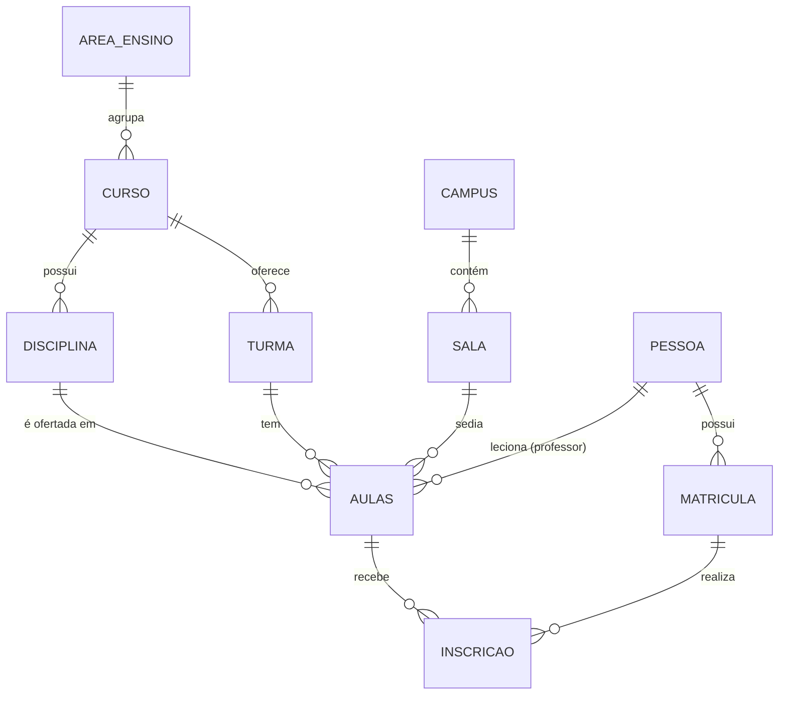

# Documentação — Banco de Dados de Gestão Acadêmica

## 1. Objetivo

Construir um banco de dados relacional para o tema **Gestão Acadêmica** (*alunos, disciplinas, turmas e matrículas*), criando as tabelas (`CREATE TABLE`), populando-as (`INSERT`) e respondendo perguntas de negócio com consultas (`SELECT`), no mesmo formato do exercício da Loja Fictícia feito em sala.

SGBD utilizado: **SQLite**, pelo DB Browser for SQLite.

## 2. Visão geral do domínio

A gestão acadêmica organiza o encontro entre pessoas e conteúdo. Os conceitos principais são:

- **Pessoa**: cadastro único de qualquer indivíduo da instituição (aluno ou professor).
- **Matrícula**: registro da pessoa na instituição, com número, tipo (aluno ou professor) e situação (ativa ou inativa).
- **Área de ensino**: agrupamento de cursos (ex.: Tecnologia da Informação).
- **Curso**: formação oferecida, com carga horária total.
- **Disciplina**: conteúdo do currículo de um curso, com carga horária própria.
- **Turma**: grupo de um curso em um semestre e turno.
- **Aula**: oferta de uma disciplina para uma turma, com professor, sala e turno.
- **Campus e sala**: estrutura física onde as aulas acontecem.
- **Inscrição**: vínculo entre um aluno e uma aula, com nota, frequência e situação.

### Relacionamentos

| Relação | Cardinalidade | Descrição |
|---|---|---|
| Área de ensino → Curso | 1:N | Uma área agrupa vários cursos; cada curso pertence a uma área |
| Curso → Disciplina | 1:N | Cada disciplina pertence a um curso |
| Curso → Turma | 1:N | Um curso pode ter várias turmas |
| Turma → Aula | 1:N | Uma turma tem várias aulas |
| Disciplina → Aula | 1:N | Uma disciplina pode ser ofertada em várias aulas |
| Pessoa (professor) → Aula | 1:N | Um professor ministra várias aulas |
| Campus → Sala | 1:N | Um campus possui várias salas |
| Sala → Aula | 1:N | Uma sala recebe várias aulas |
| Pessoa → Matrícula | 1:N | Uma pessoa pode ter registros de matrícula |
| Matrícula (aluno) ↔ Aula | N:N | Resolvida pela tabela `inscricao` |

Caminhos indiretos importantes:

- **Aluno → disciplina**: `matricula` → `inscricao` → `aulas` → `disciplina`
- **Aluno → professor**: `matricula` → `inscricao` → `aulas` → `pessoa` (professor)
- **Aluno → turma**: `matricula` → `inscricao` → `aulas` → `turma`

## 3. Modelo de dados

### 3.1 Dicionário de dados

**pessoa**

| Coluna | Tipo | Restrições |
|---|---|---|
| id | INT | PK |
| nome | VARCHAR(100) | NOT NULL |
| cpf | VARCHAR(14) | NOT NULL, UNIQUE |
| email | VARCHAR(100) | NOT NULL, UNIQUE |

**area_ensino**

| Coluna | Tipo | Restrições |
|---|---|---|
| id | INT | PK |
| nome | VARCHAR(100) | NOT NULL |
| descricao | VARCHAR(255) | |

**curso**

| Coluna | Tipo | Restrições |
|---|---|---|
| id | INT | PK |
| nome | VARCHAR(100) | NOT NULL |
| descricao | VARCHAR(255) | |
| horas_totais | INT | NOT NULL |
| id_area_ensino | INT | NOT NULL, FK → area_ensino(id) |
| disponivel | BOOLEAN | NOT NULL |

**disciplina**

| Coluna | Tipo | Restrições |
|---|---|---|
| id | INT | PK |
| nome | VARCHAR(100) | NOT NULL |
| descricao | VARCHAR(255) | |
| horas_individuais | INT | NOT NULL |
| id_curso | INT | NOT NULL, FK → curso(id) |

**turma**

| Coluna | Tipo | Restrições |
|---|---|---|
| id | INT | PK |
| semestre | INT | NOT NULL |
| turno | VARCHAR(20) | NOT NULL |
| id_curso | INT | NOT NULL, FK → curso(id) |

**campus**

| Coluna | Tipo | Restrições |
|---|---|---|
| id | INT | PK |
| nome | VARCHAR(100) | NOT NULL |
| endereco | VARCHAR(255) | NOT NULL |

**sala**

| Coluna | Tipo | Restrições |
|---|---|---|
| id | INT | PK |
| id_campus | INT | NOT NULL, FK → campus(id) |

**matricula**

| Coluna | Tipo | Restrições |
|---|---|---|
| id | INT | PK |
| numero_matricula | BIGINT | NOT NULL, UNIQUE |
| tipo | INT | NOT NULL (1 = aluno, 2 = professor) |
| ativa | BOOLEAN | NOT NULL (1 = ativa, 0 = inativa) |
| id_pessoa | INT | NOT NULL, FK → pessoa(id) |

**aulas**

| Coluna | Tipo | Restrições |
|---|---|---|
| id | INT | PK |
| id_turma | INT | NOT NULL, FK → turma(id) |
| id_sala | INT | NOT NULL, FK → sala(id) |
| id_professor | INT | NOT NULL, FK → pessoa(id) |
| id_disciplina | INT | NOT NULL, FK → disciplina(id) |
| turno | VARCHAR(20) | NOT NULL |

**inscricao** (criada em `complemento-inscricao.sql`)

| Coluna | Tipo | Restrições |
|---|---|---|
| id | INT | PK |
| id_matricula | INT | NOT NULL, FK → matricula(id) |
| id_aula | INT | NOT NULL, FK → aulas(id) |
| nota_final | DECIMAL(4,2) | NULL enquanto a nota não é lançada |
| frequencia | INT | NOT NULL, entre 0 e 100 |
| situacao | VARCHAR(20) | NOT NULL: Cursando, Aprovado, Reprovado ou Trancado |

`UNIQUE (id_matricula, id_aula)`: o mesmo aluno não se inscreve duas vezes na mesma aula.

## 4. Regras de negócio

1. A disciplina de uma aula deve pertencer ao curso da turma.
2. O turno da aula deve ser igual ao turno da turma.
3. O professor de uma aula deve ser uma pessoa com matrícula de tipo 2 e ativa.
4. Aluno e professor são distinguidos pelo campo `matricula.tipo`.
5. Aprovação (dados de exemplo): nota maior ou igual a 6 **e** frequência maior ou igual a 75%.

O SELECT 7 verifica automaticamente as regras 1, 2 e 3.

## 5. Scripts e ordem de execução

| Ordem | Arquivo | Função |
|---|---|---|
| 1 | `create-table.sql` | Cria as tabelas principais e de relacionamento |
| 2 | `insert-values.sql` | Insere os dados de exemplo |
| 3 | `complemento-inscricao.sql` | Cria `inscricao` e insere os dados dos alunos |
| 4 | `SELECT.sql` | Consultas 1 a 4 |
| 5 | `SELECT-novos.sql` | Consultas 5 a 9 |

### Volume dos dados de exemplo

| Tabela | Registros |
|---|---|
| pessoa | 8 (5 alunos e 3 professores) |
| area_ensino | 3 |
| curso | 5 (um indisponível) |
| disciplina | 11 |
| turma | 6 |
| campus | 3 |
| sala | 8 |
| matricula | 8 (uma de aluno inativa) |
| aulas | 12 |
| inscricao | 15 |

## 6. Consultas

### SELECT 1 — Ranking de professores
**Pergunta:** Quais professores ministram mais disciplinas, em quantas turmas e quais são elas?
**Técnica:** JOIN múltiplo, COUNT DISTINCT, STRING_AGG.
**Resultado esperado:** os 3 professores ministram 4 disciplinas cada.
**Atenção:** `STRING_AGG(DISTINCT d.nome, ', ')` é sintaxe do PostgreSQL e gera o erro `DISTINCT aggregates must have exactly one argument` no SQLite. No DB Browser, use `GROUP_CONCAT(DISTINCT d.nome)`.

### SELECT 2 — Auditoria de carga horária
**Pergunta:** Quais cursos têm a soma das horas das disciplinas diferente da carga horária declarada?
**Técnica:** HAVING com cálculo.
**Resultado:** os 4 cursos com disciplinas divergem, pois só parte das disciplinas está cadastrada (ex.: Ciência da Computação declara 3200h e soma 320h). O curso de Engenharia de Produção não aparece porque não tem disciplinas e a consulta usa JOIN.

### SELECT 3 — Campus mais movimentado
**Pergunta:** Qual campus tem mais aulas e quantas salas utiliza?
**Técnica:** JOIN em cadeia, contagem dupla.
**Resultado:** Campus Centro (5 aulas, 3 salas), Campus Barreiro (4 aulas, 3 salas) e Campus Contagem (3 aulas, 2 salas).

### SELECT 4 — Área de ensino
**Pergunta:** Qual área tem mais cursos e maior carga horária acumulada?
**Técnica:** LEFT JOIN, CASE dentro de COUNT, AVG.
**Resultado:** Tecnologia da Informação (3 cursos ativos, 8000h), Administração e Negócios (1 curso, 3000h) e Engenharia (1 curso, 0 ativos, 3600h).

### SELECT 5 — Possíveis conflitos de sala e turno
**Pergunta:** Quais aulas estão alocadas na mesma sala e no mesmo turno?
**Técnica:** self join em `aulas`, 9 joins, CASE.
**Resultado:** 3 pares (sala 2 no Campus Centro, sala 5 no Campus Barreiro e sala 7 no Campus Contagem), todos da mesma turma.
**Limitação:** a tabela `aulas` não tem dia da semana nem horário, então o conflito é apenas potencial. Para confirmar, seria preciso criar `dia_semana`, `hora_inicio` e `hora_fim`.

### SELECT 6 — Cobertura da grade por turma
**Pergunta:** Quantas disciplinas da grade do curso cada turma tem ofertadas, e qual a situação da turma?
**Técnica:** LEFT JOIN, subquery correlacionada, NULLIF, COALESCE, CASE.
**Resultado:** a turma 6 (ADS vespertino) está sem aulas (0%); a turma 2 (Ciência da Computação matutino) tem 25% da grade; as turmas 1, 3, 4 e 5 têm a grade completa.

### SELECT 7 — Painel de integridade dos dados
**Pergunta:** Os dados respeitam as regras de negócio? Quantas ocorrências existem em cada verificação?
**Técnica:** UNION ALL, subquery no FROM, NOT EXISTS, LEFT JOIN com IS NULL, LIKE, CASE.
**Resultado:** 11 verificações. Com os dados atuais: 3 pares de aulas na mesma sala e turno (ATENÇÃO), 1 turma sem aulas (ATENÇÃO), 1 matrícula de aluno inativa (INFORMATIVO) e as demais OK.

### SELECT 8 — Desempenho por turma (requer `inscricao`)
**Pergunta:** Como está o desempenho de cada turma, considerando turmas com pelo menos 3 inscrições?
**Técnica:** tabela derivada, HAVING, subquery escalar, BETWEEN, SUM(CASE), NULLIF.
**Resultado:**

| Turma | Curso | Alunos | Média | Aprovação | Classificação |
|---|---|---|---|---|---|
| 1 | Ciência da Computação | 2 | 7,43 | 71,4% | ATENÇÃO |
| 4 | Administração | 1 | 5,83 | 66,7% | ATENÇÃO |
| 5 | Engenharia de Software | 1 | sem notas | sem avaliações concluídas | SEM AVALIAÇÕES CONCLUÍDAS |

### SELECT 9 — Alunos ativos abaixo da média geral (requer `inscricao`)
**Pergunta:** Quais alunos com matrícula ativa estão com média abaixo da média geral da instituição (7,18)?
**Técnica:** join de 8 tabelas, subquery escalar no HAVING e no SELECT, MIN, CASE, LIMIT.
**Resultado:** Gabriela Mendes Alves (média 5,83; risco médio) e Bruno Henrique Lima (média 6,5; risco alto).

## 7. Limitações e melhorias possíveis

- A tabela `matricula` original não relaciona aluno com turma; o `complemento-inscricao.sql` resolve isso.
- `aulas` não registra dia da semana e horário, impedindo detectar conflitos reais de agenda.
- A coluna `tipo` de `matricula` poderia ser uma tabela de domínio (ex.: `tipo_matricula`).
- `disciplina` pertence a um único curso; disciplinas compartilhadas entre cursos exigiriam um relacionamento N:N.
- O SELECT 1 usa sintaxe do PostgreSQL e precisa de ajuste para rodar no SQLite.

## 8. Divisão do trabalho

| Integrante | Responsabilidade |
|---|---|
| Leandro | `CREATE TABLE` e criação do repositório |
| Miguel | `INSERT` |
| Marcos | SELECTs 1 a 4 e apresentação |
| João Pedro | SELECTs 5 a 9, complemento da tabela `inscricao`, documentação e README |
